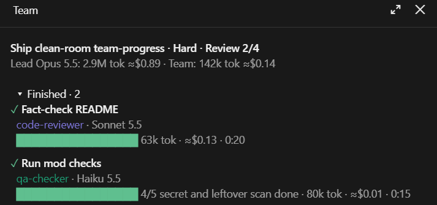

# Agent Progress Mod

`team-progress` is a Claude Code mod for a "lead and agents" workflow, where the main session triages
coding tasks and delegates them to subagents (`engineer`, `senior-engineer`, `code-reviewer`,
`qa-checker`, `design-advisor`, `Explore`, forks).


- **A progress band above the prompt** shows the lead's current task: its tier (Trivial, Standard,
  Hard, Very hard), its phase (Triage, Plan, Build, Review, QA, Commit), a progress bar, and tasks done
  out of planned during Build and Review. ✕ dismisses it.

| While agents run | When they finish |
|---|---|
|  |  |

- **A team panel** (`/team`, or the band's Team button) lists the subagents of the current task
  (running, finished and planned) with each one's role, model, self-reported steps, tokens, estimated
  cost and time, plus the lead's own tokens and cost. Finished agents are cleared when a new task
  starts. The panel opens by itself once per task, when work is first delegated.

## Install

```
/plugin install team-progress --marketplace Oralino/agent-progress-mod
```

Answer `y` to add the marketplace, pick a scope, then restart the session or run `/reload-plugins`.

## Make your agents report

The panel shows model, tokens, cost and time for every subagent with no setup. The progress band and
the per-agent step bars need two small additions to your own setup:

1. **Workers:** any agent whose frontmatter has a `tools:` list needs `mcp__team-progress__step` added
   to it. The mod adds a short step-reporting request to the briefs of `engineer`,
   `senior-engineer`, `qa-checker` and forks.
2. **The lead:** add a rule like this to your `~/.claude/CLAUDE.md`:

   ```markdown
   ## Progress reporting

   If the `team-progress` mod is loaded (`mcp__team-progress__progress` is listed, possibly as a deferred
   tool to load with ToolSearch), the lead reports each coding task to it. Skip this for questions and quick reads.
   - After triage: `title`, `tier`, `phase: "triage"`.
   - After planning: `tasks` (each with `role`; a delegated task's `title` must equal the Agent `description`
     it is spawned with; `role: "lead"` for inline work), `phase: "build"`.
   - On each phase change (`review`, `qa`, `commit`) and each time a task is accepted (`done`).
   - Once at the end: `finished: true`.
   - Always send the call in the same message as another tool call (in parallel), never in a message of
     its own: a call alone costs a whole extra turn.
   ```

Reporting should add roughly a few hundred tokens per agent (an estimate, not measured), as long as
calls are batched with other tool calls.
Cost figures are estimates from a built-in price table.
