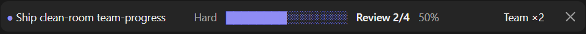
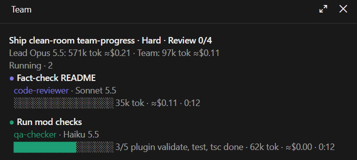
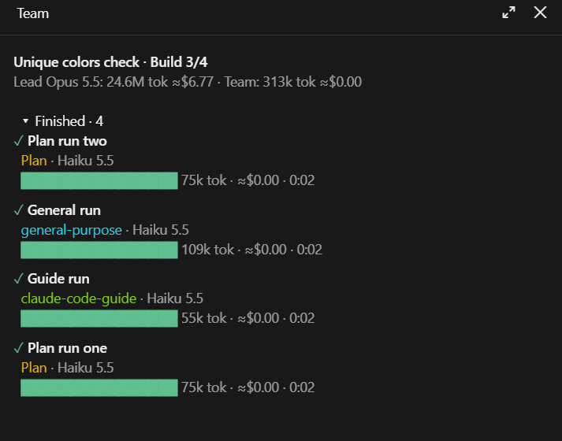

# Agent Progress Mod

`team-progress` is a Claude Code mod that shows what your session and its subagents are doing while
the main session (the lead) plans a task and delegates parts of it. Install it and it works: no
config files to edit.



- **A progress band above the prompt** shows the lead's current task: its tier if it sizes tasks
  (Trivial, Standard, Hard, Very hard), its phase (Triage, Plan, Build, Review, QA, Commit), a progress bar, and tasks done
  out of planned during Build and Review. ✕ dismisses it. It shows for any real task, whether or not
  subagents are used; if the session forgets to report, the band starts by itself after a few tool
  calls, titled from your message.

| While agents run | When they finish |
|---|---|
|  |  |

- **A team panel** (`/team`, or the band's Team button) lists the subagents of the current task
  (running, finished and planned) with each one's agent type, model, self-reported steps, tokens, estimated
  cost and time, plus the lead's own tokens and cost. Finished agents are cleared when a new task
  starts. The panel opens by itself once per task, when work is first delegated.

Works with any agents: the built-in `general-purpose` agent, your own agents in `~/.claude/agents/`, or
a plugin's. Each agent type gets its own color, never shared with another type, and keeps it
across runs and sessions. Claude Code's built-in types have fixed colors; any other type is given an
unused color the first time it appears. Quick lookup agents (`Explore`, `Plan`) are tracked but not asked to report steps.



## Install

In a Claude Code session:

```
/plugin install team-progress --marketplace Oralino/agent-progress-mod
```

Answer `y` to add the marketplace and pick a scope. Or from a shell:

```
claude plugin install team-progress --marketplace Oralino/agent-progress-mod
```

Then restart Claude Code (or run `/reload-plugins`). The one-step install needs Claude Code 2.1.275
or later. Mods run on Claude Code's early-access hooks API, which may change between releases.

## Setup

None. The mod adds a short section to the main session's system prompt telling it when to report
progress, and adds a step-reporting request to each working subagent's brief.

One optional step: if one of your agents limits its tools with a `tools:` line in its frontmatter,
add `mcp__team-progress__step` to that line, or that agent can't report its steps. It still shows in
the panel with its model, tokens, cost and time.

## Cost

Reporting should add a few hundred tokens per agent (an estimate, not measured), since the mod asks
for every report to ride along with another tool call instead of taking a turn of its own. Cost
figures in the panel are estimates from a built-in price table, not billing data.

## Uninstall

```
/plugin uninstall team-progress
```
